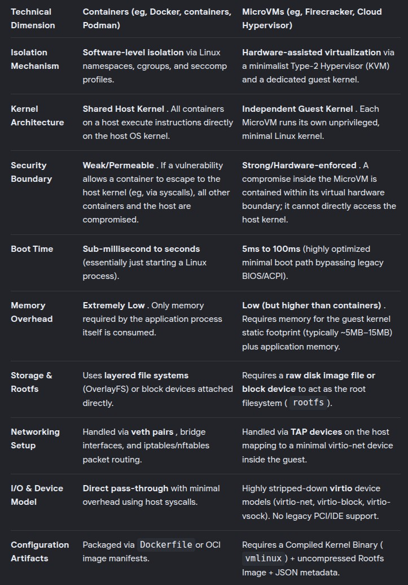

# AI Isolation using microVM

Set up an Ubuntu 24.04 microVM and run an AI agent in this isolated environment.

## Contents

- [1. Install Firecracker](#1-install-firecracker)
- [2. Prepare the Ubuntu 24.04 microVM](#2-prepare-the-ubuntu-2404-microvm)
- [3. Configure host networking](#3-configure-host-networking)
- [4. Configure the microVM](#4-configure-the-microvm)
- [5. Start the microVM](#5-start-the-microvm)
- [6. Configure microVM networking](#6-configure-microvm-networking)
- [7. Run AI in isolation](#7-run-ai-in-isolation)
- [8. Maintenance](#8-maintenance)
- [9. Misc](#9-misc)

## 1. Install Firecracker

```bash
❯ mkdir firecracker && cd firecracker

❯ arch=$(uname -m)

❯ rel="https://github.com/firecracker-microvm/firecracker/releases"

❯ latest=$(basename $(curl -fsSLI -o /dev/null -w "%{url_effective}" ${rel}/latest))

❯ curl -fsSL ${rel}/download/${latest}/firecracker-${latest}-${arch}.tgz | tar -xz

❯ mv release-${latest}-${arch}/firecracker-${latest}-${arch} firecracker

❯ chmod +x firecracker

❯ ./firecracker --version | head -1
Firecracker v1.17.0
```

## 2. Prepare the Ubuntu 24.04 microVM

```bash
❯ base="https://s3.amazonaws.com/spec.ccfc.min/firecracker-ci/v1.15/x86_64"

❯ curl -fsSL "${base}/vmlinux-6.1.155" -o vmlinux.bin

❯ curl -fsSL "${base}/ubuntu-24.04.squashfs" -o rootfs.squashfs
```

```bash
❯ unsquashfs -d rootfs-dir rootfs.squashfs

Parallel unsquashfs: Using 16 processors
7798 inodes (9789 blocks) to write

created 7079 files
created 1466 directories
created 717 symlinks
created 0 devices
created 0 fifos
created 0 sockets

# 20GB
❯ mkfs.ext4 -d rootfs-dir rootfs.ext4 20G

❯ mke2fs 1.46.5 (30-Dec-2021)

Creating regular file rootfs.ext4
Creating filesystem with 307200 4k blocks and 76800 inodes
Filesystem UUID: 5ad958f4-5092-43e4-93ef-9b2297982369
Superblock backups stored on blocks:
	32768, 98304, 163840, 229376, 294912

Allocating group tables: done
Writing inode tables: done
Creating journal (8192 blocks): done
Copying files into the device: done
Writing superblocks and filesystem accounting information: done
```

## 3. Configure host networking

### Remove existing TAP interface (if needed)

```bash
❯ sudo ip link set fctap0 down

❯ sudo ip tuntap del dev fctap0 mode tap
```

### Create the TAP interface

```bash
❯ sudo ip tuntap add dev fctap0 mode tap

❯ sudo ip addr add 172.16.0.1/24 dev fctap0

❯ sudo ip link set fctap0 up
```

### Route traffic through the host interface

Use your connected network interface; this example uses `wlo1`.

```bash
# allow packet forward in the host kernel
❯ sudo sysctl -w net.ipv4.ip_forward=1

❯ sudo iptables -t nat -A POSTROUTING -o wlo1 -j MASQUERADE

❯ sudo iptables -A FORWARD -m conntrack --ctstate RELATED,ESTABLISHED -j ACCEPT

❯ sudo iptables -A FORWARD -i fctap0 -o wlo1 -j ACCEPT

# Open any port needed, here 8080 for the AI server
# Allow the VM to talk to port 8080 of the host
❯ sudo iptables -A INPUT -i fctap0 -p tcp --dport 8080 -j ACCEPT
```

## 4. Configure the microVM

```bash
# minimal config with networking (host: 172.16.0.1 ; VM: 172.16.0.2)
# nomodule => do not load .ko

❯ cat vm_config.json
```

```json
{
  "boot-source": {
    "kernel_image_path": "vmlinux.bin",
    "boot_args": "console=ttyS0 reboot=k panic=1 pci=off nomodule rw ip=172.16.0.2::172.16.0.1:255.255.255.0::eth0:off"
  },
  "network-interfaces": [{
    "iface_id": "eth0",
    "host_dev_name": "fctap0",
    "guest_mac": "06:00:AC:10:00:02"
  }],
  "drives": [{
    "drive_id": "rootfs",
    "path_on_host": "rootfs.ext4",
    "is_root_device": true,
    "is_read_only": false
  }],
  "machine-config": {
    "vcpu_count": 4,
    "mem_size_mib": 4096
  }
}
```

## 5. Start the microVM

```bash
❯ ./firecracker --no-api --config-file vm_config.json
```

```text
2026-11-05T13:35:11.244081527 [anonymous-instance:main] Running Firecracker v1.17.0
2026-11-05T13:35:11.295553739 [anonymous-instance:main] Artificially kick devices
2026-11-05T13:35:11.296310158 [anonymous-instance:fc_vcpu 2] Received a VcpuEvent::Resume message with immediate_exit enabled. immediate_exit was disabled before proceeding
2026-11-05T13:35:11.296549220 [anonymous-instance:fc_vcpu 0] Received a VcpuEvent::Resume message with immediate_exit enabled. immediate_exit was disabled before proceeding
2026-11-05T13:35:11.296554893 [anonymous-instance:fc_vcpu 1] Received a VcpuEvent::Resume message with immediate_exit enabled. immediate_exit was disabled before proceeding
2026-11-05T13:35:11.296611670 [anonymous-instance:fc_vcpu 3] Received a VcpuEvent::Resume message with immediate_exit enabled. immediate_exit was disabled before proceeding
2026-11-05T13:35:11.296757618 [anonymous-instance:main] Successfully started microvm that was configured from one single json
2026-11-05T13:35:11.319527171 [anonymous-instance:fc_vcpu 0] vcpu: IO write @ 0xcf8:0x4 failed: Failed to find address range.
2026-11-05T13:35:11.319606718 [anonymous-instance:fc_vcpu 0] vcpu: IO read @ 0xcfc:0x2 failed: Failed to find address range.
[    0.000000] Linux version 6.1.155+ (root@c3d8009cd6d2) (gcc (Ubuntu 11.4.0-1ubuntu1~22.04.2) 11.4.0, GNU ld (GNU Binutils for Ubuntu) 2.38) #1 SMP PREEMPT_DYNAMIC Thu Dec 18 15:17:16 UTC 2025
[    0.000000] Command line: console=ttyS0 reboot=k panic=1 pci=off pci=off root=/dev/vda rw virtio_mmio.device=4K@0xc0001000:5
[    0.000000] KASLR disabled
[...]
[    1.645968] systemd[1]: Detected architecture x86-64.

Welcome to Ubuntu 24.04.3 LTS!

[    1.651183] systemd[1]: Hostname set to <ubuntu-fc-uvm>.
[    1.990136] systemd[1]: Queued start job for default target graphical.target.
[...]
[  OK  ] Finished fcnet.service.
[  OK  ] Finished systemd-update-utmp-runle…e - Record Runlevel Change in UTMP.

Ubuntu 24.04.3 LTS ubuntu-fc-uvm ttyS0

ubuntu-fc-uvm login: root (automatic login)

Welcome to Ubuntu 24.04.3 LTS (GNU/Linux 6.1.155+ x86_64)

 * Documentation:  https://help.ubuntu.com
 * Management:     https://landscape.canonical.com
 * Support:        https://ubuntu.com/pro

This system has been minimized by removing packages and content that are
not required on a system that users do not log into.

To restore this content, you can run the 'unminimize' command.

The programs included with the Ubuntu system are free software;
the exact distribution terms for each program are described in the
individual files in /usr/share/doc/*/copyright.

Ubuntu comes with ABSOLUTELY NO WARRANTY, to the extent permitted by
applicable law.

root@ubuntu-fc-uvm:~#
```

## 6. Configure microVM networking

### Set the IP address and default route

```bash
❯ ip addr add 172.16.0.2/24 dev eth0

❯ ip link set eth0 up

❯ ip route add default via 172.16.0.1 dev eth0

❯ rm -f /etc/resolv.conf

# DNS from our router
❯ echo "nameserver 192.168.1.1" > /etc/resolv.conf

# Or another one
❯ echo "nameserver 8.8.8.8" > /etc/resolv.conf

# prevent a networking service to modify it
❯ chattr +i /etc/resolv.conf

# check inet

❯ ip a

1: lo: <LOOPBACK,UP,LOWER_UP> mtu 65536 qdisc noqueue state UNKNOWN group default qlen 1000
    link/loopback 00:00:00:00:00:00 brd 00:00:00:00:00:00
    inet 127.0.0.1/8 scope host lo
       valid_lft forever preferred_lft forever
    inet6 ::1/128 scope host noprefixroute
       valid_lft forever preferred_lft forever
2: eth0: <BROADCAST,MULTICAST,UP,LOWER_UP> mtu 1500 qdisc pfifo_fast state UP group default qlen 1000
    link/ether 06:00:ac:10:00:02 brd ff:ff:ff:ff:ff:ff
    inet 172.16.0.2/30 scope global eth0
       valid_lft forever preferred_lft forever
    inet6 fe80::400:acff:fe10:2/64 scope link
       valid_lft forever preferred_lft forever
```

```bash
❯ ping -c 2 172.16.0.1
PING 172.16.0.1 (172.16.0.1) 56(84) bytes of data.
64 bytes from 172.16.0.1: icmp_seq=1 ttl=64 time=0.777 ms
64 bytes from 172.16.0.1: icmp_seq=2 ttl=64 time=0.519 ms

❯ ping -c 2 www.google.com
PING www.google.com (142.251.152.119) 56(84) bytes of data.
64 bytes from 142.251.152.119: icmp_seq=1 ttl=114 time=16.7 ms
64 bytes from 142.251.152.119: icmp_seq=2 ttl=114 time=16.2 ms
```

## 7. Run AI in isolation

### Host side: run the AI server

Run server (or use online provider) on port 8080 (host: 172.16.0.1)

```bash
❯ ./llama-server ...
```

### VM side: prepare and run the agent

```bash
# set root pwd
❯ passwd root

❯ stty rows 48 cols 140
❯ export TERM=xterm-256color

❯ apt update
❯ apt install openssh-server

# not recommended (better to create a regular user)
❯ echo "PermitRootLogin yes" >> /etc/ssh/sshd_config
❯ systemctl restart ssh

# from here we can access the VM through SSH
# which is far more easier than the vm tty
```

#### Install Git

```bash
❯ apt install git
```

#### Install mise

```bash
❯ apt install -y extrepo
❯ extrepo enable mise
❯ apt update
❯ apt install -y mise

❯ echo 'eval "$(mise activate bash)"' >> ~/.bashrc
❯ source ~/.bashrc
❯ mise --version
❯ mise doctor
```

#### Set up Python with uv (preferred)

```bash
❯ mise use -g uv@latest
❯ mise which uv
❯ uv --version

❯ uv python install 3.14
❯ uv venv ai-test --python 3.14
❯ source ai-test/bin/activate
```

#### Alternative: install dependencies with pip

```bash
❯ apt install python3-pip
❯ python3 -m pip install httpx2 rich textual openai
```

#### Install / Run Codex or other

```bash
❯ git clone https://github.com/devpack-ai/py-ai.git
❯ cd py-ai/
❯ uv pip install -r requirements.txt

❯ python3 py-ai.py --base-url=http://172.16.0.1:8080/v1/ --api-key=your_key
```

## 8. Maintenance

### Extend the VM disk (if needed)

```bash
❯ truncate -s 50G rootfs.ext4
❯ e2fsck -f rootfs.ext4
❯ resize2fs rootfs.ext4
```

### Mount and explore the filesystem

```bash
❯ mkdir -p mount_rootfs

❯ sudo mount -o loop rootfs.ext4 mount_rootfs/

❯ ll mount_rootfs/

total 68
drwxr-xr-x 14 root root  4096 Nov  5 13:35 ./
drwxrwxr-x  5 tony tony  4096 Nov  9 11:00 ../
lrwxrwxrwx  1 tony tony     7 Apr 22  2024 bin -> usr/bin/
drwxr-xr-x  2 tony tony  4096 Dec 18  2025 dev/
drwxr-xr-x 64 tony tony  4096 Nov  8 20:42 etc/
drwxr-xr-x  3 tony tony  4096 Oct 13  2025 home/
lrwxrwxrwx  1 tony tony     7 Apr 22  2024 lib -> usr/lib/
lrwxrwxrwx  1 tony tony     9 Apr 22  2024 lib64 -> usr/lib64/
drwx------  2 root root 16384 Nov  5 13:33 lost+found/
drwxr-xr-x  2 tony tony  4096 Dec 18  2025 proc/
drwx------  9 root tony  4096 Nov  9 10:15 root/
drwxr-xr-x  2 tony tony  4096 Dec 18  2025 run/
lrwxrwxrwx  1 tony tony     8 Apr 22  2024 sbin -> usr/sbin/
drwxr-xr-x  2 root root  4096 Nov  5 13:35 srv/
drwxr-xr-x  2 tony tony  4096 Dec 18  2025 sys/
drwxr-xr-x  2 tony tony  4096 Dec 18  2025 tmp/
drwxr-xr-x 12 tony tony  4096 Oct 13  2025 usr/
drwxr-xr-x  7 tony tony  4096 Nov  8 14:22 var/
```

### Remove the TAP interface (host)

```bash
❯ sudo ip link set fctap0 down

❯ sudo ip tuntap del dev fctap0 mode tap
```

## 9. Misc

Firecracker: https://firecracker-microvm.github.io/

### Containers vs microVMs



